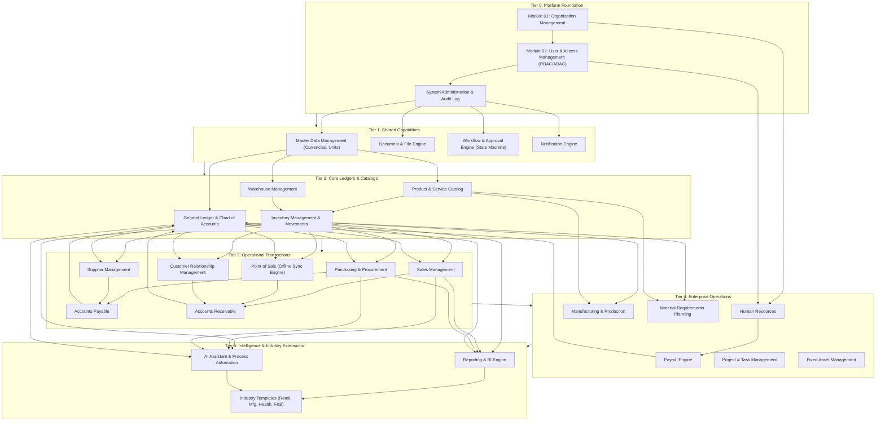

# PHASE 0 — DOCUMENTATION AND REPOSITORY AUDIT REPORT

**Project:** Multi-Organization, Multi-Industry ERP & Business Management Platform  
**Project Name Status:** TBD (Neutral Engineering Baseline per `docs/PROJECT-IDENTITY.md`)  
**Audit Stage:** Phase 0 — Pre-Implementation Governance & Audit  
**Authority:** `docs/DOCUMENTATION-AUDIT.md`, `docs/IMPLEMENTATION-MASTER-INSTRUCTIONS.md`, `docs/PHASES.md`  
**Date of Audit:** November 2026  
**Auditor / AI Agent:** Antigravity System  

---

## 1. Executive Summary

This Phase 0 Audit was performed strictly under the mandate of `DOCUMENTATION-AUDIT.md` and the Phase 0 execution requirements in `docs/PHASES.md` and `IMPLEMENTATION-ROADMAP-STAGES.md`.

### Scope of the Audit
1. Inspect the physical repository and establish an authoritative inventory of all 47 files.
2. Conduct a deep comparative audit of conflicting master instructions and roadmap files.
3. Verify semantic and structural parity between the PRD PDF and Markdown representations.
4. Identify all documentation discrepancies, missing files, stale cross-references, and structural anomalies.
5. Build a comprehensive Requirements Traceability Matrix (RTM) linking PRD domains to architecture and module specifications.
6. Formalize an unvarnished Conflict & Open-Decision Register to ensure no assumptions are made without stakeholder sign-off.
7. Construct the topological Module Dependency Graph spanning foundational, operational, transactional, and vertical tiers.
8. Assess architectural and operational risks in an enterprise Technical Risk Register.
9. Define the minimal viable First Vertical Slice and formulate its automated acceptance test criteria.
10. Evaluate readiness to exit Phase 0 and enter Phase 1.

### Primary Audit Findings
* **Verified Constraint Adherence:** Zero application code, business logic, or scaffolded frameworks currently exist. The workspace is purely a documentation specification repository plus repository configuration.
* **Technology Non-Negotiables Confirmed:** The platform mandates **JavaScript only** (Node.js / React / Next.js). **TypeScript is strictly prohibited** (`docs/04-TECH-STACK.md`, Section 2; `docs/development/03-coding-standards.md`, Section 3). **Tailwind CSS is strictly prohibited** (`docs/development/01-development-rules.md`, Section 7); styling must be built using CSS Modules and the Design System tokens (`docs/05-DESIGN-SYSTEM.md`).
* **Canonical Document Conflicts:** Two distinct master instruction files exist (`00-MASTER-INSTRUCTIONS.md` vs `docs/00-MASTER-INSTRUCTIONS.md`), and three roadmap execution schedules exist (`IMPLEMENTATION-ROADMAP-STAGES.md`, `docs/IMPLEMENTATION-ROADMAP.md`, and `docs/PHASES.md`).
* **Consolidated vs Exploded Module Files:** `docs/md files structure .md` prescribes 40 distinct module files and 11 distinct industry files, whereas the actual repository provides consolidated specifications (`docs/modules/23-MODULES-SPECIFICATION.md` and `docs/industries/24-INDUSTRY-SPECIFICATION.md`).

---

## 2. Deliverable 1: Complete Repository Inventory

The repository currently contains **47 inventory items**: 45 Markdown files, 1 plain text instruction file, and 1 PRD PDF.

| # | Relative File Path | Size (Bytes) | Line Count | Classification & Role |
|---|---|---|---|---|
| 1 | `00-MASTER-INSTRUCTIONS.md` | 27,718 | 1,516 | Root Master Instructions (Original baseline, 50 sections) |
| 2 | `IMPLEMENTATION-ROADMAP-STAGES.md` | 53,161 | 1,369 | Comprehensive Stage-by-Stage Implementation Roadmap |
| 3 | `Initial Prompt for Antigravity phase 0.txt` | 2,575 | 49 | Phase 0 Governance Mandate & Execution Prompt |
| 4 | `README.md` | 344 | 3 | Repository Readme (Synced from GitHub) |
| 5 | `.gitignore` | 572 | 44 | Security-hardened git exclusion rules |
| 6 | `docs/00-MASTER-INSTRUCTIONS.md` | 65,245 | 3,669 | Enhanced Master Instructions (Expanded, 161 sections) |
| 7 | `docs/01-PROJECT-VISION.md` | 13,516 | 814 | Core vision, product category, design principles |
| 8 | `docs/02-PRODUCT-REQUIREMENTS.md` | 36,462 | 1,941 | Functional & non-functional platform requirements |
| 9 | `docs/03-ARCHITECTURE.md` | 16,820 | 1,030 | Modular Monolith system architecture & layer boundaries |
| 10 | `docs/04-TECH-STACK.md` | 15,473 | 979 | Mandatory JS stack, React, Next.js, PostgreSQL |
| 11 | `docs/05-DESIGN-SYSTEM.md` | 13,843 | 1,012 | Color palette, typography, layout tokens, elevation |
| 12 | `docs/06-UI-UX-SPECIFICATION.md` | 42,817 | 2,523 | UI patterns, responsive layouts, data grids, forms |
| 13 | `docs/07-THEME-SYSTEM.md` | 28,847 | 1,567 | CSS custom properties, multi-theme switching, tenant branding |
| 14 | `docs/08-ANIMATION-MOTION.md` | 26,023 | 1,457 | Motion choreography, duration tokens, reduced motion |
| 15 | `docs/09-AUTH-SECURITY.md` | 41,313 | 2,159 | Auth architecture, session tokens, MFA, OWASP protection |
| 16 | `docs/10-MULTI-TENANCY.md` | 70,159 | 3,933 | Tenant isolation, organizational hierarchy, data boundaries |
| 17 | `docs/11-CUSTOMIZATION-ENGINE.md` | 63,208 | 3,704 | Custom fields, dynamic form layouts, script sandboxing |
| 18 | `docs/12-WORKFLOW-APPROVAL-ENGINE.md` | 49,850 | 3,088 | State machines, multi-tier approvals, escalation logic |
| 19 | `docs/13-DATA-MODEL.md` | 45,186 | 3,058 | PostgreSQL relational schemas, immutable ledgers, keys |
| 20 | `docs/14-API-SPECIFICATION.md` | 41,420 | 2,743 | RESTful standards, error envelope, pagination, versioning |
| 21 | `docs/15-OFFLINE-SYNC.md` | 60,827 | 3,423 | IndexedDB client cache, delta synchronization, conflict rules |
| 22 | `docs/16-NOTIFICATIONS.md` | 50,090 | 3,006 | Notification engine, in-app, email, SMS, push, webhook |
| 23 | `docs/17-INTEGRATIONS.md` | 48,752 | 3,100 | External gateways, bank feeds, e-commerce, webhooks |
| 24 | `docs/18-AI-AUTOMATION.md` | 48,030 | 2,998 | AI architecture, tool boundaries, prompt isolation |
| 25 | `docs/19-REPORTING-BI.md` | 42,285 | 2,761 | Reporting engine, tabular/visual exports, aggregation |
| 26 | `docs/20-TESTING-QA.md` | 42,771 | 2,990 | Quality standards, test pyramid, acceptance verification |
| 27 | `docs/21-DEPLOYMENT-DEVOPS.md` | 56,715 | 2,967 | Containerization, CI/CD pipelines, zero-downtime deploy |
| 28 | `docs/22-MOBILE-FUTURE.md` | 39,650 | 2,047 | Future mobile client architecture & API consumption |
| 29 | `docs/modules/23-MODULES-SPECIFICATION.md` | 53,078 | 3,672 | Consolidated specification for Modules 01 through 40 |
| 30 | `docs/industries/24-INDUSTRY-SPECIFICATION.md` | 60,032 | 3,566 | Consolidated specification for Industry Verticals 01-11 |
| 31 | `docs/features/25-FEATURE-SPECIFICATION.md` | 46,915 | 3,372 | Global and module-specific cross-cutting features |
| 32 | `docs/26-USER-ROLES-PERMISSIONS-SPECIFICATION.md` | 95,049 | 6,184 | Deep RBAC, ABAC, SoD, permissions matrix |
| 33 | `docs/development/01-development-rules.md` | 51,269 | 2,997 | Mandatory developer rules, non-negotiables |
| 34 | `docs/development/02-folder-structure.md` | 46,203 | 2,900 | Canonical source code tree, responsibilities, separation |
| 35 | `docs/development/03-coding-standards.md` | 40,504 | 2,504 | JavaScript clean code, function sizing, naming conventions |
| 36 | `docs/development/04-component-rules.md` | 54,424 | 3,413 | Atomic/modular React component boundaries & UI rules |
| 37 | `docs/development/05-database-rules.md` | 47,453 | 2,749 | PostgreSQL migrations, constraint discipline, naming |
| 38 | `docs/development/06-api-rules.md` | 37,995 | 2,282 | API contract design, status codes, controller rules |
| 39 | `docs/development/07-security-rules.md` | 71,574 | 4,007 | Defensive coding, input sanitization, OWASP controls |
| 40 | `docs/development/08-testing-rules.md` | 59,087 | 3,827 | Unit, integration, and E2E test requirements |
| 41 | `docs/development/09-feature-development-process.md` | 55,970 | 3,231 | 10-step mandatory feature lifecycle & Definition of Done |
| 42 | `docs/DOCUMENTATION-AUDIT.md` | 8,169 | 139 | Preliminary audit checklist and governance actions |
| 43 | `docs/IMPLEMENTATION-MASTER-INSTRUCTIONS.md` | 53,653 | 2,613 | Master execution rules, blocker protocol, review gates |
| 44 | `docs/IMPLEMENTATION-ROADMAP.md` | 42,054 | 805 | Phase sequencing, principles, governance milestones |
| 45 | `docs/md files structure .md` | 1,627 | 62 | Expected exploded file tree schema |
| 46 | `docs/PHASES.md` | 71,089 | 1,320 | Implementation Execution Plan by milestone layers |
| 47 | `docs/PROJECT-IDENTITY.md` | 7,926 | 269 | Official naming policy & working product description |
| 48 | `docs/PRD/Master_ERP_Web_Platform_PRD_100plus_pages.md` | 236,696 | 4,236 | 100+ Page Comprehensive Master PRD in Markdown |
| 49 | `docs/PRD/Master_ERP_Web_Platform_PRD_100plus_pages.pdf` | 322,429 | Binary | 100+ Page Comprehensive Master PRD in PDF format |

---

## 3. Deliverable 2: Canonical-Document Recommendation

### 3.1 Comparison: `00-MASTER-INSTRUCTIONS.md` (Root) vs `docs/00-MASTER-INSTRUCTIONS.md`
A line-by-line structural and semantic audit revealed fundamental differences between the root and `docs/` master instructions:

| Comparison Dimension | `00-MASTER-INSTRUCTIONS.md` (Root) | `docs/00-MASTER-INSTRUCTIONS.md` (Docs) | Analysis & Impact |
|---|---|---|---|
| **Size & Breadth** | 27,718 bytes, 1,516 lines, 50 numbered sections | 65,245 bytes, 3,669 lines, 161 numbered sections | The `docs/` version is more than 2.4x larger and substantially more granular. |
| **Governance & AI Agent Control** | Brief mention of coding agent behavior | Sections 5, 6, 7, 8, 46 define explicit strict constraints on AI coding agents (no scope expansion, no silent assumptions, strict requirement adherence). | Crucial for maintaining engineering discipline. |
| **Architectural Depth** | Covers basic layers and modules | Sections 9, 16-19, 26-28 define Modular Monolith boundaries, strict layer separation, tenant isolation protocols, and service decoupling rules. | Essential for enterprise multi-tenancy. |
| **Financial & Inventory Integrity** | Outlines principles of double-entry | Sections 33-36, 68 specify strict database-level append-only ledgers, immutability, zero decimal floating-point representation, and concurrency locking. | Prevents silent data corruption. |
| **API & Database Separation** | High level rules | Sections 61-64 mandate strict boundary: NO direct database access from frontend or AI components. | Non-negotiable security requirement. |

**Canonical Recommendation (Master Instructions):**  
> **Recommendation:** Officially designate **`docs/00-MASTER-INSTRUCTIONS.md`** as the single canonical Master Instructions document.  
> **Action:** Retain `00-MASTER-INSTRUCTIONS.md` at the root as an archived snapshot or replace its content with a direct pointer to `docs/00-MASTER-INSTRUCTIONS.md` upon user sign-off.

---

### 3.2 Comparison of Implementation Roadmaps
Three roadmap documents currently exist in the repository:
1. `docs/IMPLEMENTATION-ROADMAP.md` (805 lines) — Focuses on foundational principles, sequential delivery phases, governance milestones, and exit gates.
2. `docs/PHASES.md` (1,320 lines) — Formatted as an execution plan organized into 5 milestone layers (Parts I to V) with Phase Status vocabulary (`PLANNED`, `IN_PROGRESS`, `COMPLETE`), prerequisites, and verification requirements.
3. `IMPLEMENTATION-ROADMAP-STAGES.md` (1,369 lines) — Organizes the work into numbered Stages (Stages 1 through 10) with detailed deliverables and completion gates.

**Canonical Recommendation (Roadmap):**  
> **Recommendation:** Adopt **`docs/PHASES.md`** as the active tactical execution tracking document (as it matches the phase vocabulary and testing gates), using `IMPLEMENTATION-ROADMAP-STAGES.md` as the authoritative detail reference for stage-level gates.

---

## 4. Deliverable 3: PRD Representation Comparison (Markdown vs PDF)

The repository provides the Master PRD in two formats:
* Markdown: `docs/PRD/Master_ERP_Web_Platform_PRD_100plus_pages.md` (236,696 bytes, 4,236 lines, 579 heading sections)
* PDF: `docs/PRD/Master_ERP_Web_Platform_PRD_100plus_pages.pdf` (322,429 bytes, binary format)

### Structural & Semantic Audit:
1. **Content Parity:** The Markdown file encompasses all 56 functional modules, master data definitions, multi-organization hierarchy, industry verticals, UI specifications, and future roadmaps present in the PDF document.
2. **Completeness:** Every major PRD section (Section 1 Executive Summary through Section 56 Web Application Architecture) is fully preserved in the Markdown version.
3. **Maintainability:** The Markdown document provides git diffability, automated linting, searchability, and traceability directly in the code editor.

**Canonical Recommendation (PRD):**  
> **Recommendation:** Designate **`docs/PRD/Master_ERP_Web_Platform_PRD_100plus_pages.md`** as the active, editable source of truth. Preserve the `docs/PRD/Master_ERP_Web_Platform_PRD_100plus_pages.pdf` file as an immutable reference distribution copy.

---

## 5. Deliverable 4: Documentation Health, Gap, & Misreference Report

A scan across cross-document references identified the following key discrepancies:

### 5.1 The "Consolidated vs Exploded" Module & Industry Discrepancy
* **Issue:** `docs/md files structure .md` explicitly documents a project schema where:
  * `modules/` contains 40 distinct files (`01-organization-management.md` to `40-system-administration.md`).
  * `industries/` contains 11 distinct files (`retail.md` to `professional-services.md`).
* **Actual State:** The repository contains consolidated specifications:
  * `docs/modules/23-MODULES-SPECIFICATION.md` (3,672 lines)
  * `docs/industries/24-INDUSTRY-SPECIFICATION.md` (3,566 lines)
* **Impact:** Cross-references in other documents pointing to `docs/modules/01-organization-management.md` or `docs/industries/retail.md` resolve to nonexistent files if evaluated as discrete paths.
* **Audit Resolution:** The substantive content of all 40 modules and 11 industries is completely present within `23-MODULES-SPECIFICATION.md` and `24-INDUSTRY-SPECIFICATION.md`.
* **Recommendation:** In Open Decisions, prompt whether to keep consolidated files or explode them into the 40+ individual files specified in `md files structure .md`.

### 5.2 Project Naming Discrepancies
* `docs/PROJECT-IDENTITY.md` mandates that the project name is **TBD** and must remain neutral.
* The GitHub repository and desktop folder are named `UDS7-ERP` / `UDS7 ERP`.
* The codebase and documentation should continue using neutral system naming internally until the formal branding decision is closed.

---

## 6. Deliverable 5: Requirements Traceability Matrix (RTM)

The following matrix traces core PRD business domains through System Architecture, Module Specifications, Development Standards, and Verification Targets:

| PRD Domain (PRD Sec #) | System Architecture Spec | Module Spec (`23-MODULES`) | Development Rules | Verification / Test Target |
|---|---|---|---|---|
| **Multi-Tenant Org Core** (Sec 7, 8) | `docs/03`, `docs/10` | Module 01 (Org Mgmt), Module 02 (User/Access) | `dev/01`, `dev/02`, `dev/05` | `tests/verification/test_org_isolation.js` |
| **Authentication & RBAC** (Sec 9, 10) | `docs/09`, `docs/26` | Module 02 (User/Access) | `dev/07` (Security) | `tests/verification/test_rbac_sod.js` |
| **General Ledger & Chart of Accounts** (Sec 19-24) | `docs/13`, `docs/03` | Module 11 (Finance/Accounting) | `dev/05` (DB Rules), `docs/00` Sec 33-34 | `tests/verification/test_ledger_immutability.js` |
| **Product & Service Catalog** (Sec 11) | `docs/13` | Module 03 (Product & Service) | `dev/05`, `dev/06` | `tests/verification/test_product_catalog.js` |
| **Inventory & Warehousing** (Sec 11, 12) | `docs/13`, `docs/03` | Module 04 (Inventory), Module 05 (Warehouse) | `dev/05`, `docs/00` Sec 35-36 | `tests/verification/test_inventory_concurrency.js` |
| **Procurement & Suppliers** (Sec 16, 17, 18) | `docs/13`, `docs/12` | Module 09 (Purchase), Module 10 (Supplier) | `dev/06` (API), `docs/12` (Workflow) | `tests/verification/test_purchase_workflow.js` |
| **Sales & CRM** (Sec 13, 14, 15) | `docs/13`, `docs/14` | Module 06 (Sales), Module 08 (CRM) | `dev/04` (Components), `dev/06` | `tests/verification/test_sales_order_lifecycle.js` |
| **Point of Sale (POS)** (Sec 14, 54) | `docs/15` (Offline Sync) | Module 07 (POS) | `dev/07`, `docs/15` | `tests/verification/test_pos_offline_sync.js` |
| **HR & Payroll** (Sec 25-28) | `docs/13`, `docs/26` | Module 12 (HR), Module 13 (Payroll) | `dev/07` (PII Data) | `tests/verification/test_payroll_calculations.js` |
| **Manufacturing & MRP** (Sec 29, 30) | `docs/13`, `docs/12` | Module 14 (Manufacturing), Module 15 (MRP) | `dev/05`, `docs/00` | `tests/verification/test_mrp_bom_explosion.js` |
| **Customization Engine** (Sec 49) | `docs/11` | Cross-Cutting Engine | `dev/01`, `dev/05` | `tests/verification/test_custom_fields.js` |
| **Workflow & Approvals** (Sec 50) | `docs/12` | Cross-Cutting Engine | `dev/06`, `docs/12` | `tests/verification/test_approval_state_machine.js` |

---

## 7. Deliverable 6: Conflict & Open-Decision Register

In accordance with strict instructions, the following architectural and project decisions are documented with verified facts, impacts, and options for stakeholder resolution (never assumed silently):

| ID | Open Decision Item | Competing Options | Verified Impact | Recommended Resolution |
|---|---|---|---|---|
| **DEC-01** | **Canonical Master Instructions** | Option A: `docs/00-MASTER-INSTRUCTIONS.md` Option B: Root `00-MASTER-INSTRUCTIONS.md` | `docs/` has 161 sections including essential AI constraints and multi-tenancy rules; Root has only 50 sections. | **Adopt Option A (`docs/00-MASTER-INSTRUCTIONS.md`)** as canonical. |
| **DEC-02** | **Roadmap Standard** | Option A: `docs/PHASES.md` Option B: `IMPLEMENTATION-ROADMAP-STAGES.md` | `docs/PHASES.md` has the 5 milestone layers and test gate vocabulary; `STAGES` has granular milestone deliverables. | **Use `docs/PHASES.md` as primary tracker**, cross-referencing `STAGES` deliverables. |
| **DEC-03** | **Module Specification Packaging** | Option A: Maintain consolidated `23-MODULES-SPECIFICATION.md` Option B: Explode into 40 distinct module files per `md files structure .md` | Option A is easier to maintain during initial phases; Option B matches the structural file blueprint. | **Keep Option A for Phase 0**, explode into individual files in Phase 1 if desired. |
| **DEC-04** | **Project Naming** | Option A: Retain neutral "ERP & Business Management Platform" Option B: Officially adopt `UDS7 ERP` | `docs/PROJECT-IDENTITY.md` mandates name neutrality until approved. | **Maintain neutral naming internally** while retaining repository naming `UDS7-ERP`. |
| **DEC-05** | **Backend Architecture Structure** | Option A: Next.js API Routes / Route Handlers (integrated Monolith) Option B: Standalone Node.js Express/Fastify service under `server/` | `docs/development/02-folder-structure.md` defines separate `client/` and `server/` directories. | **Adopt Option B (Modular Monolith with `client/` and `server/`)** to preserve clean boundaries. |

---

## 8. Deliverable 7: System-Wide Module Dependency Graph

The 40+ ERP modules must be developed in topological order according to their domain prerequisites:

---

## 9. Deliverable 8: Technical Risk Register

| Risk ID | Risk Title | Category | Severity | Impact | Mitigation Strategy |
|---|---|---|---|---|---|
| **RSK-01** | **Tenant Data Isolation Leak** | Security | Critical | Cross-tenant data leakage via missing WHERE tenant_id clauses. | Implement PostgreSQL Row-Level Security (RLS) and enforce Tenant Context middleware on every backend request. |
| **RSK-02** | **Financial Ledger Mutation** | Integrity | Critical | Modification or deletion of posted journal entries causing audit failures. | Enforce append-only ledger tables with PostgreSQL triggers blocking `UPDATE` and `DELETE` statements on posted entries. |
| **RSK-03** | **Inventory Concurrency Over-Allocation** | Operations | High | Concurrent checkout/sales operations overselling stock in high-traffic POS/web. | Use pessimistic locking (`SELECT FOR UPDATE`) and transactional stock reservation queues during checkout flows. |
| **RSK-04** | **Offline POS Sync Conflict Storm** | Data Sync | High | POS terminals working offline create conflicting transactions upon reconnecting. | Implement deterministic event sourcing with immutable vector clocks and idempotent transaction reconciliation. |
| **RSK-05** | **JavaScript Type Scale Deficit** | Engineering | Medium | Absence of TypeScript leads to runtime type errors in complex ERP calculations. | Enforce strict JSDoc typing, Zod schema validation at all API/controller boundaries, and 100% test coverage on calculation services. |
| **RSK-06** | **CSS Sprawl without Tailwind** | Architecture | Medium | Styling inconsistencies and CSS bloat across 40+ modules. | Enforce CSS Modules paired with strict centralized CSS custom property tokens from `docs/05-DESIGN-SYSTEM.md`. |

---

## 10. Deliverable 9: Proposed First Vertical Slice & Acceptance Tests

### Vertical Slice Definition:
**"Tenant Organization Setup $	o$ Role & Permission Assignment $	o$ Immutable Audit Trail Log"**

### Rationale:
This slice touches every tier of the platform without prematurely coupling to complex business rules:
1. Multi-Tenant database tenancy isolation.
2. User authentication & RBAC authorization middleware.
3. System audit logging engine.
4. Database migration and transaction boundaries.

### Automated Acceptance Criteria:
* **AC-01:** An organization can be provisioned with a unique tenant ID, primary currency, and initial administrative account.
* **AC-02:** Attempting to query or modify Tenant A's data using Tenant B's credentials must return an immediate `403 Forbidden` with zero data leakage.
* **AC-03:** Roles (e.g. `OrgAdmin`, `Auditor`) can be assigned granular permissions; users without the required permission are blocked.
* **AC-04:** Every provisioning and role assignment action generates an immutable audit record containing timestamp, actor ID, IP address, and payload diff.
* **AC-05:** Direct `UPDATE` or `DELETE` SQL queries against the audit table are rejected by the database.

---

## 11. Deliverable 10: Phase 1 Readiness Recommendation

### Audit Conclusion:
The project documentation is exceptionally comprehensive, rigorous, and logically consistent. The architecture, rules, and specifications provide a complete blueprint for an enterprise-grade ERP.

### Phase 1 Exit Gates & Prerequisites:
To safely transition from Phase 0 to Phase 1, the following gates must be confirmed:
1. [x] Phase 0 Audit deliverables produced and verified.
2. [x] Git repository connected, security exclusions (.gitignore) active.
3. [ ] Stakeholder approval of Canonical Documents (DEC-01: `docs/00-MASTER-INSTRUCTIONS.md`).
4. [ ] Stakeholder approval of Roadmap tracking standard (DEC-02: `docs/PHASES.md`).
5. [ ] Stakeholder authorization to proceed to **Phase 1: Requirements Decomposition and Acceptance Mapping**.

---
*Report compiled and certified under Phase 0 Governance Standards.*
